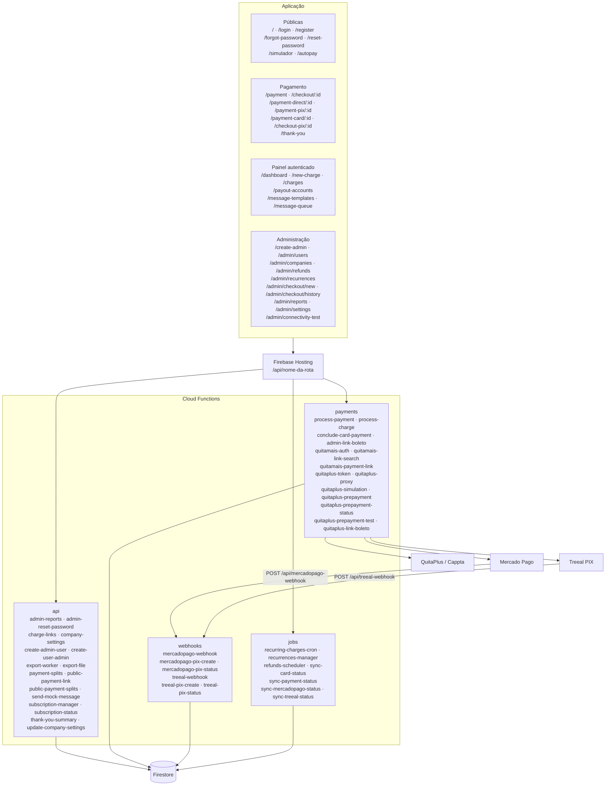

# Sistema de Pagamentos QuitaMais

## Informações do projeto

**URL**: https://lovable.dev/projects/eaddac47-07ed-4011-8ff8-fc1b25fafe6b

## Sobre o projeto

Sistema completo de pagamentos integrado com a API QuitaMais para processamento de transações via cartão de crédito. O projeto oferece:

## Arquitetura

O navegador usa o Firebase Hosting. Cada chamada `/api/<rota>` cai em uma de quatro Cloud Functions na região `southamerica-east1`. Mercado Pago e Treeal enviam o aviso de pagamento para os webhooks. O grupo `payments` fala com a QuitaPlus/Cappta para cartão, boleto e link.



As rotas de administração exigem papel de administrador. O painel exige usuário autenticado. Pagamento, simulador e autopay são públicos. `mercadopago-webhook` e `treeal-webhook` aceitam GET para validação do provedor e POST com o aviso de pagamento.

### Funcionalidades implementadas
- **Múltiplas opções de pagamento**: parcelamento flexível, pagamento único com desconto, valores personalizados
- **Formulário completo**: captura de dados do pagador e informações do cartão de crédito
- **Validação em tempo real**: CPF/CNPJ, telefone, e-mail, dados do cartão
- **Integração QuitaMais**: processamento via API oficial da Cappta
- **Armazenamento seguro**: histórico de transações no Firestore
- **Interface responsiva**: design otimizado para conversão

### Dados capturados
**Dados do pagador:**
- Nome completo
- CPF ou CNPJ (com formatação automática)
- E-mail (validação de formato)
- Telefone (formato brasileiro: (11) 99999-9999)

**Dados do cartão:**
- Nome no cartão
- Número do cartão (formatação automática: 0000 0000 0000 0000)
- Data de validade (MM/AA)
- CVV (3 ou 4 dígitos)

### Opções de pagamento
1. **Menor parcela**: R$ 124,75 em 12x
2. **Pagamento único**: R$ 1.197,60 (desconto de R$ 299,40)
3. **Parcelamento popular**: R$ 249,50 em 6x (opção mais escolhida)
4. **Valor personalizado**: o cliente define o valor da parcela

## Como editar este código?

Há várias formas de editar a aplicação.

**Usar o Lovable**

Acesse o [projeto no Lovable](https://lovable.dev/projects/eaddac47-07ed-4011-8ff8-fc1b25fafe6b) e comece a descrever as alterações.

As mudanças feitas pelo Lovable são commitadas automaticamente neste repositório.

**Usar o editor de sua preferência**

Para trabalhar localmente, clone este repositório e envie as alterações. O que for enviado também aparece no Lovable.

O único requisito é ter Node.js e npm instalados — [instale com o nvm](https://github.com/nvm-sh/nvm#installing-and-updating).

Siga estes passos:

```sh
# Passo 1: clone o repositório usando a URL Git do projeto.
git clone <URL_DO_GIT>

# Passo 2: entre na pasta do projeto.
cd <NOME_DO_PROJETO>

# Passo 3: instale as dependências.
npm i

# Passo 4: inicie o servidor de desenvolvimento, com recarga automática e pré-visualização.
npm run dev
```

**Editar um arquivo direto no GitHub**

- Abra o arquivo desejado.
- Clique em "Edit" (ícone de lápis) no canto superior direito da visualização.
- Faça as alterações e confirme o commit.

**Usar o GitHub Codespaces**

- Abra a página principal do repositório.
- Clique no botão "Code" (botão verde), perto do canto superior direito.
- Selecione a aba "Codespaces".
- Clique em "New codespace" para abrir um ambiente novo.
- Edite os arquivos dentro do Codespace e envie as alterações quando terminar.

## Quais tecnologias este projeto usa?

O projeto é feito com:

- Vite
- TypeScript
- React
- shadcn-ui
- Tailwind CSS
- Firebase (autenticação e Firestore)
- API QuitaMais (processamento de pagamentos)

## Configuração necessária

### 1. Credenciais QuitaMais
Defina no ambiente do servidor em `functions/`:
- `QUITA_MAIS_MERCHANT_ID` — identificador do comerciante QuitaMais
- `QUITA_MAIS_CREDITOR_NAME` — nome do credor
- `QUITA_MAIS_CREDITOR_DOCUMENT` — documento do credor

O administrador também pode gravar esses valores no Firestore (`app_settings/quita_mais`) pela tela de configurações.

### 2. Dados das transações
As cobranças e transações ficam no Firestore, com campos como:

- `transaction_id` — identificador único da transação
- `merchant_id` — identificador do comerciante QuitaMais
- `creditor_name` — nome do credor
- `creditor_document` — documento do credor
- `amount_in_cents` — valor em centavos
- `installments` — número de parcelas
- `payer_document` — CPF/CNPJ do pagador
- `payer_email` — e-mail do pagador
- `payer_phone_number` — telefone do pagador
- `payer_name` — nome do pagador
- `card_holder_name` — nome no cartão
- `card_number_last_four` — últimos 4 dígitos do cartão
- `status` — situação da transação (AUTHORIZED, REJECTED, PENDING)
- `authorization_code` — código de autorização

### 3. Fluxo de pagamento

1. O cliente acessa `/payment`
2. Seleciona a opção de pagamento desejada
3. Preenche os dados pessoais e do cartão
4. O sistema valida os dados em tempo real
5. A função processa o pagamento pela API QuitaMais
6. A transação é salva no banco de dados
7. O cliente recebe a confirmação

### 4. Segurança

- Validação de CPF/CNPJ
- Formatação automática de campos
- Criptografia SSL de ponta a ponta
- Regras de acesso por linha habilitadas
- Registros detalhados para auditoria

## Como publicar este projeto?

Abra o [Lovable](https://lovable.dev/projects/eaddac47-07ed-4011-8ff8-fc1b25fafe6b) e clique em Compartilhar → Publicar.

## Posso conectar um domínio próprio ao projeto Lovable?

Sim.

Para conectar um domínio, vá em Projeto → Configurações → Domínios e clique em Conectar domínio.

Saiba mais em: [Configurar um domínio próprio](https://docs.lovable.dev/tips-tricks/custom-domain#step-by-step-guide)
